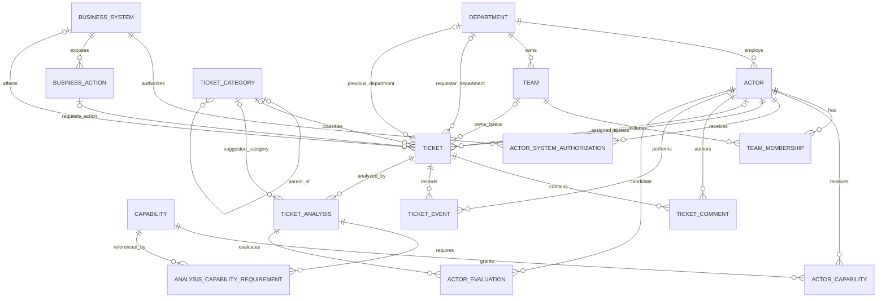
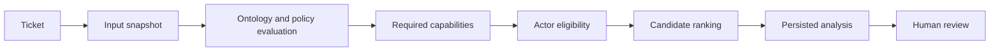

# Data model

## Purpose

This document describes the persistence model used by the semantic service
desk. The model is divided into four contexts that progressively support the
ticket analysis workflow:

1. Identity and Organization
2. Service Catalog
3. Ticketing
4. Ticket Analysis

Prisma models and fields use `PascalCase` and `camelCase`. PostgreSQL tables
and columns are explicitly mapped to plural `snake_case` table names and
`snake_case` column names.

## Entity relationship diagram

The diagram is logical. Relation labels distinguish cases where the same two
entities are connected more than once, such as the requester and assignee of a
ticket.

## Identity and Organization

### Department

Represents an organizational area where actors and operational teams belong.

| Field                    | Required | Description                                          |
| ------------------------ | -------- | ---------------------------------------------------- |
| `id`                     | Yes      | UUID identifier.                                     |
| `code`                   | Yes      | Unique, stable business code.                        |
| `name`                   | Yes      | Display name.                                        |
| `description`            | No       | Human-readable purpose.                              |
| `active`                 | Yes      | Whether the department is available for current use. |
| `createdAt`, `updatedAt` | Yes      | Audit timestamps.                                    |

### Team

Represents an operational resolver group or queue owned by a department. A
team groups actors for routing, but membership alone does not prove that an
actor has a capability or authorization.

| Field                    | Required | Description                                    |
| ------------------------ | -------- | ---------------------------------------------- |
| `id`                     | Yes      | UUID identifier.                               |
| `departmentId`           | Yes      | Owning department.                             |
| `code`                   | Yes      | Unique, stable business code.                  |
| `name`                   | Yes      | Display name.                                  |
| `description`            | No       | Human-readable purpose.                        |
| `active`                 | Yes      | Whether the team is available for current use. |
| `createdAt`, `updatedAt` | Yes      | Audit timestamps.                              |

### Actor

Represents a participant that may request, resolve, approve, or perform work.
Its type describes its nature, not its contextual role.

`ActorType` values:

- `HUMAN`
- `AI_AGENT`
- `SERVICE`

| Field                    | Required | Description                                  |
| ------------------------ | -------- | -------------------------------------------- |
| `id`                     | Yes      | UUID identifier.                             |
| `departmentId`           | Yes      | Actor's current department.                  |
| `type`                   | Yes      | Nature of the actor.                         |
| `name`                   | Yes      | Display name.                                |
| `email`                  | No       | Unique contact address when applicable.      |
| `active`                 | Yes      | Whether the actor may currently participate. |
| `createdAt`, `updatedAt` | Yes      | Audit timestamps.                            |

### TeamMembership

Represents a time-bounded relationship between an actor and a team. A null
`endedAt` identifies a current membership.

| Field       | Required | Description                |
| ----------- | -------- | -------------------------- |
| `id`        | Yes      | UUID identifier.           |
| `teamId`    | Yes      | Related team.              |
| `actorId`   | Yes      | Related actor.             |
| `startedAt` | Yes      | Membership start.          |
| `endedAt`   | No       | Membership end.            |
| `createdAt` | Yes      | Record creation timestamp. |

### Capability

Represents knowledge or an ability that may be required to resolve a ticket.
It answers what an actor knows how to do, not whether the actor is authorized
to act on a particular system.

| Field                    | Required | Description                                          |
| ------------------------ | -------- | ---------------------------------------------------- |
| `id`                     | Yes      | UUID identifier.                                     |
| `code`                   | Yes      | Unique code referenced by rules and the ontology.    |
| `name`                   | Yes      | Display name.                                        |
| `description`            | No       | Human-readable meaning.                              |
| `active`                 | Yes      | Whether the capability is available for current use. |
| `createdAt`, `updatedAt` | Yes      | Audit timestamps.                                    |

### ActorCapability

Represents a time-bounded capability grant. A null `revokedAt` identifies a
current grant.

| Field          | Required | Description                     |
| -------------- | -------- | ------------------------------- |
| `id`           | Yes      | UUID identifier.                |
| `actorId`      | Yes      | Actor receiving the capability. |
| `capabilityId` | Yes      | Granted capability.             |
| `grantedAt`    | Yes      | Grant start.                    |
| `revokedAt`    | No       | Grant revocation.               |
| `createdAt`    | Yes      | Record creation timestamp.      |

## Service Catalog

### BusinessSystem

Represents a business or technical system affected by requests.

| Field                    | Required | Description                                       |
| ------------------------ | -------- | ------------------------------------------------- |
| `id`                     | Yes      | UUID identifier.                                  |
| `code`                   | Yes      | Unique code referenced by rules and the ontology. |
| `name`                   | Yes      | Display name.                                     |
| `description`            | No       | Human-readable purpose.                           |
| `active`                 | Yes      | Whether the system is available for current use.  |
| `createdAt`, `updatedAt` | Yes      | Audit timestamps.                                 |

### BusinessAction

Represents an action performed within a business system, such as creating or
approving a purchase order.

| Field                    | Required | Description                                      |
| ------------------------ | -------- | ------------------------------------------------ |
| `id`                     | Yes      | UUID identifier.                                 |
| `systemId`               | Yes      | System exposing the action.                      |
| `code`                   | Yes      | Globally unique action code.                     |
| `name`                   | Yes      | Display name.                                    |
| `description`            | No       | Human-readable meaning.                          |
| `active`                 | Yes      | Whether the action is available for current use. |
| `createdAt`, `updatedAt` | Yes      | Audit timestamps.                                |

### TicketCategory

Represents a hierarchical classification. A root category has no `parentId`;
child categories refine the problem type.

| Field                    | Required | Description                                        |
| ------------------------ | -------- | -------------------------------------------------- |
| `id`                     | Yes      | UUID identifier.                                   |
| `parentId`               | No       | Parent category in the hierarchy.                  |
| `code`                   | Yes      | Globally unique category code.                     |
| `name`                   | Yes      | Display name.                                      |
| `description`            | No       | Human-readable meaning.                            |
| `active`                 | Yes      | Whether the category is available for current use. |
| `createdAt`, `updatedAt` | Yes      | Audit timestamps.                                  |

### ActorSystemAuthorization

Represents whether an actor is allowed to act on a system. It is independent
from capability: an actor may know how to perform work without being
authorized to execute it in a specific system.

| Field       | Required | Description                |
| ----------- | -------- | -------------------------- |
| `id`        | Yes      | UUID identifier.           |
| `actorId`   | Yes      | Authorized actor.          |
| `systemId`  | Yes      | Authorized system.         |
| `grantedAt` | Yes      | Authorization start.       |
| `revokedAt` | No       | Authorization revocation.  |
| `createdAt` | Yes      | Record creation timestamp. |

## Ticketing

### Ticket

Represents a reported problem or service request. Optional catalog fields may
be populated by the requester, enriched by an LLM, or suggested by an
analysis. Department references preserve the organizational context relevant
to cases such as a requester changing departments.

`TicketStatus` values:

- `OPEN`
- `TRIAGED`
- `IN_PROGRESS`
- `WAITING_FOR_REQUESTER`
- `RESOLVED`
- `CLOSED`
- `CANCELED`

`TicketPriority` values: `LOW`, `MEDIUM`, `HIGH`, and `CRITICAL`.

`TicketSource` values: `WEB`, `API`, and `AGENT`.

| Field                    | Required | Description                                      |
| ------------------------ | -------- | ------------------------------------------------ |
| `id`                     | Yes      | UUID identifier.                                 |
| `number`                 | Yes      | Unique, automatically incremented public number. |
| `title`, `description`   | Yes      | Human-provided request.                          |
| `status`                 | Yes      | Current lifecycle status; defaults to `OPEN`.    |
| `priority`               | Yes      | Operational priority; defaults to `MEDIUM`.      |
| `source`                 | Yes      | Creation channel; defaults to `API`.             |
| `requesterId`            | Yes      | Actor experiencing or reporting the problem.     |
| `assigneeId`             | No       | Actor currently selected to resolve it.          |
| `teamId`                 | No       | Resolver queue currently owning it.              |
| `categoryId`             | No       | Current classification.                          |
| `affectedSystemId`       | No       | System affected by the problem.                  |
| `requestedActionId`      | No       | Action the requester needs to perform.           |
| `requesterDepartmentId`  | No       | Department relevant when the ticket was opened.  |
| `previousDepartmentId`   | No       | Previous department relevant to the problem.     |
| `dueAt`                  | No       | Operational deadline.                            |
| `resolutionSummary`      | No       | Human-readable resolution.                       |
| `resolvedAt`, `closedAt` | No       | Lifecycle timestamps.                            |
| `version`                | Yes      | Optimistic concurrency version, initially `1`.   |
| `createdAt`, `updatedAt` | Yes      | Audit timestamps.                                |

### TicketComment

Represents requester-visible or internal collaboration on a ticket.

`TicketCommentVisibility` values: `PUBLIC` and `INTERNAL`.

| Field                    | Required | Description                     |
| ------------------------ | -------- | ------------------------------- |
| `id`                     | Yes      | UUID identifier.                |
| `ticketId`               | Yes      | Related ticket.                 |
| `authorId`               | Yes      | Actor writing the comment.      |
| `content`                | Yes      | Comment body.                   |
| `visibility`             | Yes      | Audience; defaults to `PUBLIC`. |
| `createdAt`, `updatedAt` | Yes      | Audit timestamps.               |

### TicketEvent

Represents immutable ticket history. Its JSON payload stores the data required
to explain the specific event without forcing unrelated events into the same
column structure.

`TicketEventType` values:

- `CREATED`
- `UPDATED`
- `STATUS_CHANGED`
- `ASSIGNED`
- `COMMENT_ADDED`
- `ANALYSIS_REQUESTED`
- `ANALYSIS_COMPLETED`
- `RESOLVED`
- `CLOSED`
- `CANCELED`

| Field       | Required | Description                                     |
| ----------- | -------- | ----------------------------------------------- |
| `id`        | Yes      | UUID identifier.                                |
| `ticketId`  | Yes      | Related ticket.                                 |
| `actorId`   | No       | Actor responsible for the event, if applicable. |
| `type`      | Yes      | Event type.                                     |
| `payload`   | Yes      | Event-specific JSON data.                       |
| `createdAt` | Yes      | Event occurrence timestamp.                     |

## Ticket Analysis

### TicketAnalysis

Represents one immutable analysis attempt over a ticket input. A new analysis
is created for each run so previous decisions remain explainable and
auditable.

`TicketAnalysisStatus` values: `PENDING`, `RUNNING`, `COMPLETED`, `FAILED`, and
`SUPERSEDED`.

`TicketAnalysisTrigger` values: `MANUAL`, `TICKET_CREATED`, `TICKET_UPDATED`,
and `ONTOLOGY_UPDATED`.

| Field                       | Required | Description                                         |
| --------------------------- | -------- | --------------------------------------------------- |
| `id`                        | Yes      | UUID identifier.                                    |
| `ticketId`                  | Yes      | Ticket being analyzed.                              |
| `status`                    | Yes      | Analysis lifecycle status.                          |
| `trigger`                   | Yes      | Reason the analysis was created.                    |
| `ontologyVersion`           | Yes      | Ontology version used by the run.                   |
| `inputHash`                 | Yes      | Hash used to identify the analyzed input.           |
| `inputSnapshot`             | Yes      | JSON snapshot of the effective analysis input.      |
| `suggestedCategoryId`       | No       | Category suggested by the analysis.                 |
| `classificationConfidence`  | No       | Classification score, not a resolution probability. |
| `classificationExplanation` | No       | Human-readable classification rationale.            |
| `startedAt`, `completedAt`  | No       | Execution timestamps.                               |
| `failureReason`             | No       | Failure details when status is `FAILED`.            |
| `createdAt`                 | Yes      | Record creation timestamp.                          |

### AnalysisCapabilityRequirement

Represents a capability that an analysis determined was necessary. The unique
combination of analysis, capability, and source prevents duplicate evidence.

`CapabilityRequirementSource` values: `ONTOLOGY`, `POLICY`, and `HUMAN`.

| Field          | Required | Description                         |
| -------------- | -------- | ----------------------------------- |
| `id`           | Yes      | UUID identifier.                    |
| `analysisId`   | Yes      | Owning analysis.                    |
| `capabilityId` | Yes      | Required capability.                |
| `source`       | Yes      | Origin of the requirement.          |
| `explanation`  | Yes      | Reason this capability is required. |
| `createdAt`    | Yes      | Record creation timestamp.          |

### ActorEvaluation

Represents the result of evaluating one candidate actor. Both eligible and
ineligible actors are persisted so the system can explain selection and
elimination decisions. An actor may appear only once in an analysis.

| Field              | Required | Description                                          |
| ------------------ | -------- | ---------------------------------------------------- |
| `id`               | Yes      | UUID identifier.                                     |
| `analysisId`       | Yes      | Owning analysis.                                     |
| `actorId`          | Yes      | Candidate actor.                                     |
| `eligible`         | Yes      | Whether all deterministic eligibility rules passed.  |
| `rank`             | No       | Relative position among eligible candidates.         |
| `suitabilityScore` | No       | Ranking score, not a calibrated success probability. |
| `reasons`          | Yes      | Structured JSON explanations and rule outcomes.      |
| `createdAt`        | Yes      | Record creation timestamp.                           |

## Analysis flow

The LLM may enrich human language into candidate facts, but it does not decide
eligibility. The ontology and deterministic policies derive requirements and
eliminate invalid candidates. Ranking operates only after eligibility and its
score must not be presented as a probability of resolution unless a future
calibrated predictive model supports that interpretation.
